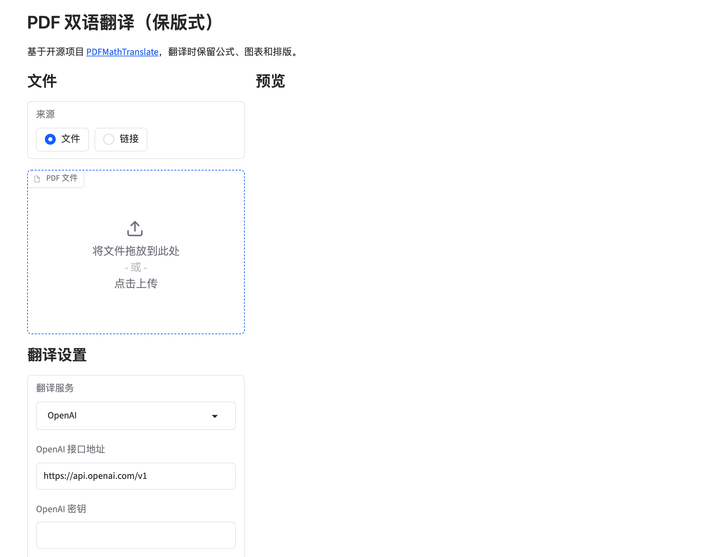

# PDF 双语翻译（保版式）

> 篝火出品 · 收录于篝火 App 应用区 · 基于开源项目 [PDFMathTranslate](https://github.com/PDFMathTranslate/PDFMathTranslate)（**AGPL-3.0**）

把论文、说明书等 PDF 翻译成另一种语言，**公式、图表和排版保持原样**，同时生成纯译文版和双语对照版。篝火版把网页界面全部改成了中文，并提供 Windows / macOS 一键启动包。

## 下载

到 [Releases](https://github.com/campfire-code/pdf-bilingual-translate/releases/latest) 下载 `pdf-bilingual-translate_版本号_portable.zip`，附 `SHA256SUMS.txt` 可核对。

| 电脑 | 怎么启动 |
|---|---|
| Windows 10 / 11 | 解压后双击「启动（Windows 双击）.bat」 |
| macOS | 解压后双击「启动（Mac 双击）.command」；第一次可能要右键选择「打开」 |

- 第一次启动会自动安装 uv、下载 Python 3.12 和依赖，需要几分钟，请保持联网；会询问是否使用国内镜像，直接回车即为使用。
- 启动后浏览器自动打开中文网页界面（没打开就访问 `http://localhost:7860/`）。关闭启动窗口即退出。
- 第一次翻译时，程序还会在线下载版面识别模型和字体，网络不好可能较慢或失败，重试即可。
- 以后再次启动不用重新安装。

## 怎么用

1. 在「文件」里上传 PDF（也可以切到「链接」填网址）。
2. 在「翻译设置」里选翻译服务、原文语言、译文语言和页码范围；选了需要密钥的服务，就在出现的输入框里填自己的接口地址、密钥和模型名。
3. 点「开始翻译」，完成后在「翻译结果」里下载译文版（仅译文）和双语对照版。

## 翻译服务（要自己选、自己配）

PDF 里的文字会发送给你选的翻译服务，请自行评估保密要求。

- **无需密钥**：Google（默认）、Bing。上游没有写明它们的额度和长期可用性，我们没有核实，正式使用前先试一份文件。
- **需要自己的密钥**：OpenAI、302.AI、DeepL、Azure OpenAI、Azure 翻译、智谱、魔搭、硅基流动、Gemini、腾讯云机器翻译、Grok、Groq、DeepSeek、MiniMax、阿里通义 Qwen-MT，以及任何兼容 OpenAI 接口的服务（选「兼容 OpenAI 接口的服务」，自己填接口地址、密钥和模型名）。
- **需要自己的服务地址**：Ollama（本机）、Xinference、DeepLX、Dify、AnythingLLM。
- 密钥只保存在你自己的电脑上，不要把它写进任何公开的文件。

## 和上游的区别

- 网页界面（标签、按钮、下拉选项、提示、报错、进度说明）改为中文，默认就是中文；内部取值和翻译逻辑不变。
- 修正了选 OpenAI 等有 6 个设置项的服务时，设置项输入框不够用、界面报错的问题。
- 新增一键启动包（`campfire/` 里的启动脚本，发布时自动打包）。
- 英文及其他语言的说明文档不进发布包。
- 移除了上游全部工作流（它们依赖上游的密钥），换成篝火的发布流程。
- 本仓库对应上游 v1.9.11。上游 2.0 版本已迁到新仓库 [PDFMathTranslate-next](https://github.com/PDFMathTranslate/PDFMathTranslate-next)，本仓库不包含。

## 已知限制

- 右侧「预览」区在部分 Gradio 版本下可能一直显示加载中（上游依赖的 PDF 预览组件与新版 Gradio 不兼容），不影响翻译和下载。
- 网页框架自带的少数提示文字（如拖放文件提示）按浏览器语言显示，浏览器是中文时即为中文。

## 验收用例

| 操作 | 应得到 |
|---|---|
| 双击启动脚本，等待浏览器打开 | 页面标题和所有说明文字均为中文 |
| 上传含公式的英文 PDF，服务选 Google，译文语言选「简体中文」，点「开始翻译」 | 生成译文版和双语对照版 PDF，公式、图表位置与原文一致 |
| 服务选「兼容 OpenAI 接口的服务」，填入地址、密钥、模型名后翻译 | 同样生成译文 PDF |

## 归属与许可证

本仓库由**篝火**整理发布，是篝火 App 应用区收录的开源工具之一。软件全部功能与版权归 [PDFMathTranslate](https://github.com/PDFMathTranslate/PDFMathTranslate) 原作者 Byaidu 及贡献者所有，按 **GNU AGPL-3.0** 许可证再分发，完整协议见仓库内 `LICENSE`，对应源码即本仓库；第三方组件见 `THIRD_PARTY_LICENSES`。上游版面引擎来自 [BabelDOC](https://github.com/funstory-ai/BabelDOC)。全部工具目录见 [toolkit-hub](https://github.com/campfire-code/toolkit-hub)。
